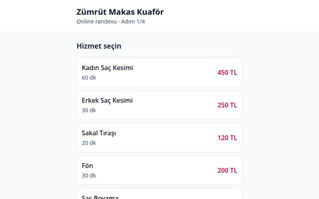
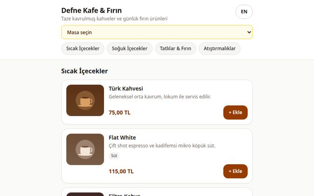
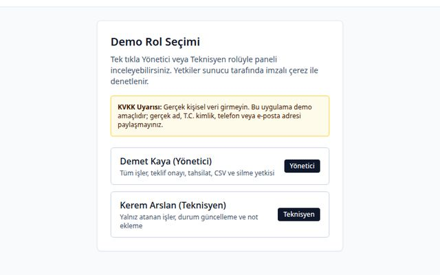
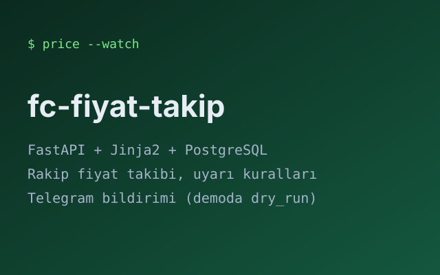
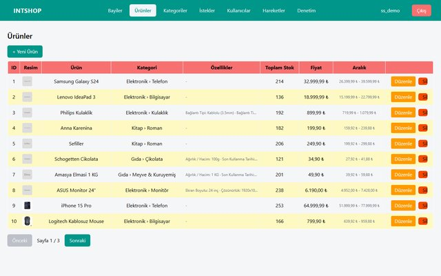
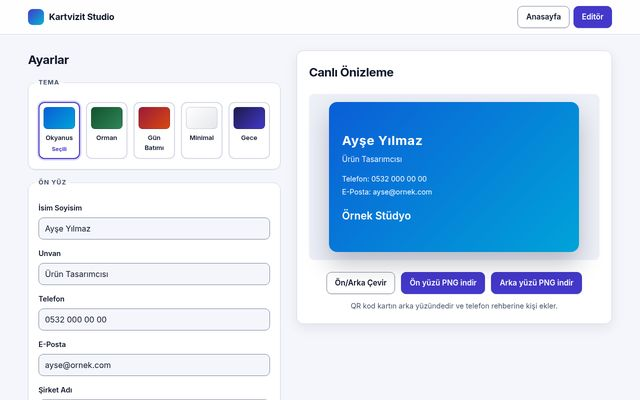

  

Küçük işletmeler için fiş/belge OCR ve otomasyon · SvelteKit, Python, PostgreSQL · Ölçülmüş teslim

  
  

  

## Ölçülmüş işler

- **Fiş OCR** (müşteri projesi, kaynak kod müşteride): 277 gerçek fiş fotoğrafı, geliştirme (221) ve hiç görülmemiş test (56) olarak ayrıldı. Vergi fişlerinde %72 otomatik doğrulama, fiş başına yaklaşık 1,8 sn, yalnızca işlemcide. Müşterinin sunucusuna HTTPS API olarak kuruldu, yük testiyle ölçüldü. Ayrıntı: [furkancol.me](https://furkancol.me/)
- **Cari Takip** (örnek proje): alacak ve taksit takibi, tek .exe masaüstü programı, iş kuralları 49 otomatik testle doğrulandı.
- **code-repo-rag ve turkish-notes-rag**: yerel RAG projeleri; tuning ve dondurulmuş test setleri ayrı. code-repo-rag'da hibrit arama hit@5 0,92 (59 soru), kavramsal sorulardaki zayıflık (hit@1 0,52) README'de açıkça yazılı.

## Öne çıkan projeler

<table>
<tr>
<td width="50%" valign="top">

<h3><a href="https://github.com/furkancol10/fc-randevu-sistemi">fc-randevu-sistemi</a></h3>

Randevu/rezervasyon sistemi.

<a href="https://github.com/furkancol10/fc-randevu-sistemi">Repo</a> &nbsp;|&nbsp; <a href="https://fc-randevu-sistemi.vercel.app/demo-kuafor">Demo</a>

</td>
<td width="50%" valign="top">

<h3><a href="https://github.com/furkancol10/fc-qr-menu">fc-qr-menu</a></h3>

QR menü ve WhatsApp sipariş.

<a href="https://github.com/furkancol10/fc-qr-menu">Repo</a> &nbsp;|&nbsp; <a href="https://fc-qr-menu.vercel.app/demo-kafe">Demo</a>

</td>
</tr>
<tr>
<td width="50%" valign="top">

<h3><a href="https://github.com/furkancol10/fc-mini-crm">fc-mini-crm</a></h3>

Teknik servis ve küçük ajanslar için teklif/iş takip paneli (SvelteKit + PostgreSQL).

<a href="https://github.com/furkancol10/fc-mini-crm">Repo</a> &nbsp;|&nbsp; <a href="https://fc-mini-crm.vercel.app/giris">Demo</a>

</td>
<td width="50%" valign="top">

<h3><a href="https://github.com/furkancol10/fc-fiyat-takip">fc-fiyat-takip</a></h3>

Rakip fiyat takibi: FastAPI + Jinja2 + PostgreSQL, uyarı kuralları, Telegram bildirimi (demoda dry_run). Canlı demo yok.

<a href="https://github.com/furkancol10/fc-fiyat-takip">Repo</a>

</td>
</tr>
<tr>
<td width="50%" valign="top">

<h3><a href="https://github.com/furkancol10/INTSHOP">INTSHOP</a></h3>

Stok/sipariş paneli (Svelte).

<a href="https://github.com/furkancol10/INTSHOP">Repo</a> &nbsp;|&nbsp; <a href="https://stok-panel-three.vercel.app">Demo</a>

</td>
<td width="50%" valign="top">

<h3><a href="https://github.com/furkancol10/CardStudio">CardStudio</a></h3>

Tarayıcıda kartvizit tasarım aracı, vCard QR kodlu, PNG çıktı, kurulumsuz.

<a href="https://github.com/furkancol10/CardStudio">Repo</a> &nbsp;|&nbsp; <a href="https://cardstudio-gamma.vercel.app">Demo</a>

</td>
</tr>
</table>

## Diğer projeler

- [code-repo-rag](https://github.com/furkancol10/code-repo-rag): Git reposu üzerinde kod-farkında RAG. AST chunking, BM25 + vektör hibrit arama (RRF), cevaplar file:line kaynaklı.
- [turkish-notes-rag](https://github.com/furkancol10/turkish-notes-rag): Türkçe notlar üzerinde framework'süz RAG. CPU'da Türkçe embedding, Ollama, retrieval eval.
